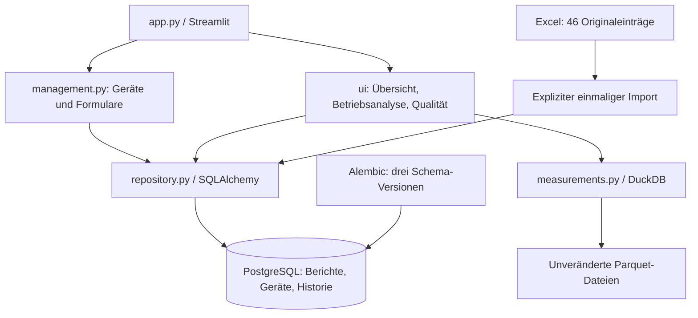

# ServicePulse beim Professor erklären

Stand: 30.10.2026, Branch `improvement/professor-demo`. Termin: 03.11.2026.

## Zweck und Forschungsfrage

ServicePulse verwaltet Geräte und Serviceberichte und untersucht vorhandene Betriebsdaten von Ultratiefkühlgeräten. Die Frage lautet: Wie lassen sich historische Serviceeinträge und Betriebszeitreihen nachvollziehbar aufbereiten und interaktiv untersuchen, sodass dokumentierte Häufigkeiten, wiederkehrende Einträge, Temperaturverläufe und Datenlücken sichtbar werden?

Es ist ein lokaler Forschungsprototyp. Er berechnet weder eine Ausfallwahrscheinlichkeit noch den nachgewiesenen Erfolg einer Reparatur.

## Quellen und eigene Arbeit

Die Forschung von Huang et al. (2023), Artikel DOI `10.1038/s41597-023-02808-6`, liefert die fachliche Grundlage. [Autorenrepository](https://lab.compute.dtu.dk/taohu/ult-freezers-labelled-dataset-sci-data), veröffentlichte Datendateien und Excel-Referenz wurden getrennt geprüft; Einzelheiten einschließlich Autorencommit und Lizenzbelegen stehen in [Repositoryprüfung](repository_pruefung.md) und [Datenimport](datenimport.md).

- `fault_summary_R1.xlsx`: 46 historische Serviceeinträge an 24 Geräten. Kontrollblätter werden zum Abgleich verwendet und nicht als weitere Berichte importiert.
- `data/raw/Revco/` und `data/raw/Haier/`: 106 veröffentlichte Parquets, 181.309.902 Mess-/Meldungszeilen für 53 Geräte. Die Dateien bleiben unverändert.
- `research/reference/`: lokale Autorenreferenz mit Code und ergänzenden CSVs. Sie dient dem Quellenvergleich, nicht als ungeprüfte Laufzeitbibliothek.

Die eigenen Bestandteile sind die validierenden Leser, Qualitätskontrollen, DuckDB-Abfragen, PostgreSQL-Verwaltung, Änderungsprotokolle, Diagramme, Oberfläche und Tests. Die vorhandenen Autoren-Parquets wurden verwendet; eine vollständige eigene Rekonstruktion aus sämtlichen Rohdateien wird nicht behauptet. Für die veröffentlichten Daten ist CC0 dokumentiert, der Artikel hat eine CC-BY-Lizenz. Eine eindeutige gesonderte Codelizenz und einzelne Drittunterlagen bleiben klärungsbedürftig; Autorencode wird nicht als eigener Code ausgegeben oder ungeprüft übernommen.

## Warum zwei Datenbankwerkzeuge?

**PostgreSQL** speichert kleine, veränderliche Tabellen: Geräte, Berichte, Kategorien, Quellen, Maßnahmen, Dateiregister und Historie. Gemeinsame Transaktionen und Datenbankregeln schützen gespeicherte Änderungen.

**DuckDB** liest große Parquet-Dateien direkt. Nur das ausgewählte Zeitfenster wird zusammengefasst. Die 181 Millionen Mess-/Meldungszeilen werden nicht in PostgreSQL kopiert. `data/processed/servicepulse.duckdb` ist lediglich die erhaltene historische Prüfreferenz, keine zweite aktuelle Berichtsdatenbank. SQLite wird ausschließlich als originales Haier-Rohdatenformat schreibgeschützt gelesen.



## Dateien, die man erklären können sollte

| Datei | Aufgabe |
|---|---|
| `app.py` | Konfigurieren, PostgreSQL-Bestand laden und vier Bereiche zusammenführen. Keine eigene Sensorberechnung. |
| `servicepulse/repository.py` | Import, Geräte, Berichte und Dateiregister. SQLAlchemy-Sessions und Transaktionen. Für Tests ist eine getrennte Verbindung übergebbar. |
| `servicepulse/models.py` | Beschreibt Tabellen, Fremdschlüssel, zulässige Werte und Berichtsversionen. Die drei Migrationen erzeugen das tatsächliche Schema samt Schutz- und Audittriggern. |
| `servicepulse/measurements.py` | Validiert Parquet-Metadaten und fragt Zeitfenster mit DuckDB ab. |
| `servicepulse/presentation.py` | Deutsche Lesehilfen, Export und Diagramme einschließlich sichtbarer Messlücken. |

Weitere Orientierung: `database.py` liest die Verbindung aus der lokalen `.env`; `management.py` enthält die Formulare. `ui/shell.py` enthält Seitenkonfiguration und Servicefilter, `ui/overview.py` die Übersicht, `ui/operation.py` die Betriebsanalyse und `ui/quality.py` die Forschungs- und Qualitätsansicht. `faults.py` liest und prüft Excel; `research.py` enthält Filterregeln, Falltexte und Prüfnachweise; `imports.py` prüft Uploads. `case_review.py` untersucht Messlücken und Zustandsbits. `raw.py` enthält unabhängige Rohdatenstichproben. `storage.py` erstellt bei explizitem Aufruf die historische DuckDB-Prüfreferenz. `scripts/prepare_database.py` trennt normalen Start und bewusste Wartung.

## Vom Formular zum gespeicherten Bericht

1. Unter **Geräte & Serviceberichte** ein Gerät öffnen. **Neuen Servicebericht erfassen** öffnet die zunächst geschlossene Maske.
2. Das Formular übergibt Angaben an `repository.save_report`. Fehlende fachliche Angaben bleiben leer beziehungsweise ausdrücklich unbekannt.
3. Eine SQLAlchemy-Session öffnet eine Transaktion. Gerät, Herkunft, Status und Änderungsgrund werden geprüft.
4. Bericht, Quelle und Maßnahme werden gemeinsam gespeichert. Scheitert ein Schritt, wird alles zurückgerollt. Ein Anforderungsschlüssel schützt gegen dieselbe wiederholte Übermittlung.
5. Der Datenbanktrigger schreibt Vorher-/Nachher-Werte, Version, Zeit und Grund ins Auditprotokoll. Die ursprüngliche Forschungszeile bleibt geschützt. `origin='research'` und `origin='manual'` trennen die Herkunft.
6. Nach dem Speichern wird die Oberfläche neu ausgeführt und liest PostgreSQL erneut. Deshalb aktualisieren sich Tabelle und Statistik. Aktive Servicefilter gelten weiterhin.

Beim Bearbeiten muss die gelesene Version noch aktuell sein. Zwei gleichzeitige Bearbeiter können dadurch nicht unbemerkt dieselbe Fassung überschreiben. Die lokale Schreibsperre serialisiert Schreibvorgänge; das ist für diesen kleinen Einzelplatzbestand ausreichend. Der frei eingegebene Bearbeitername ist keine authentifizierte Identität.

## Von Parquet zur Temperaturkurve

`series_window` prüft Messgröße und Intervall und verwendet beispielsweise:

```sql
SELECT date_trunc('hour', "Datetime") AS time,
       avg("RTD") AS mean, min("RTD") AS minimum,
       max("RTD") AS maximum, count("RTD") AS n
FROM read_parquet(?)
WHERE "Datetime" >= ? AND "Datetime" < ?
GROUP BY 1 ORDER BY 1;
```

Dateipfad und Zeitgrenzen sind Parameter. Spaltennamen werden gegen das tatsächliche Schema geprüft und maskiert; das Aggregationsintervall stammt aus einer festen erlaubten Auswahl. PostgreSQL-Abfragen entstehen aus SQLAlchemy-Ausdrücken, etwa `select(Device).order_by(Device.id)` oder `select(Audit).where(Audit.report_id == id).order_by(Audit.version)`. Texte werden nicht in freie SQL-Befehle eingesetzt.

Die Kurve erhält ein vollständiges Zeitraster, aber fehlende Rasterplätze bleiben **NaN**. Plotly verbindet diese Lücken nicht. Ein Vorher/Nachher-Vergleich schließt den kompletten Servicetag aus und zeigt Punktzahlen und beobachtete Stunden. Revco und Haier besitzen unterschiedliche Messintervalle; Punktzahlen sind daher keine geräteübergreifend gleichen Beobachtungszeiten.

## Speicherort und Start auf diesem Laptop

Arbeitsordner: `C:\Users\ammar\Downloads\fault_summary_R1`.

- PostgreSQL-Server: `127.0.0.1:55432`, Datenbank **servicepulse**. Physische Serverdateien: `data/postgresql/`. Das ist ein ganzer Serverordner, keine einzelne Projektdatei.
- SQLAlchemy-Verbindung: `servicepulse/database.py`; lokaler Verbindungswert: `.env`. Administrator-Einstellungen liegen in `data/private/postgres.json`. Diese Dateien sind nicht in Git.
- Messdateien: `data/raw/`. PostgreSQL enthält dazu Pfade und Metadaten.
- Logische PostgreSQL-Sicherungen: `data/backups/postgresql/*.dump`. Normale Starts erzeugen keine neuen Dumps; nach eigenen Eingaben bewusst sichern.

`ServicePulse.code-workspace` in VS Code öffnen, dann **F5** mit „ServicePulse: Dashboard (Streamlit)“. Alternativ im Projektterminal **`.\start.cmd`** ausführen. Browser: `http://127.0.0.1:8501`. Ein bestehendes Dashboard auf diesem Port vorher schließen.

Der normale Start prüft Server und Schemaversion. Nur auf einem noch nicht vorbereiteten Rechner wird die Erstvorbereitung aufgerufen. Ausführliche Befehle für Umgebung, Wartung und Tests stehen im [README](../README.md) und in [Windows-Start und Sicherung](postgresql_windows.md).

## Kennzahlen und wissenschaftliche Grenzen

Die Ausgangsauswahl hat **46 Einträge**, **24 Geräte mit Einträgen**, **11 Geräte mit mehreren Einträgen** und **5 wiederholte Gerät/Kategorie-Paare**. 53 ist die Zahl aller registrierten Forschungsgeräte, nicht die Zahl nachgewiesener Störungsgeräte. Leckage ist mit 11 Einträgen die häufigste zusammengefasste Kategorie.

Ein Eintrag beweist weder einen unabhängigen Ausfall noch dessen Beginn. Vergleichbare Exposition, unabhängige Störungsepisoden und bestätigte Zeitzonen fehlen. Originale Zeitstempel ohne bestätigte Zeitzone werden nicht still umgedeutet; neue Uploads mit Zeitzone benötigen zuerst eine dokumentierte Umrechnung. Drei Excel/CSV-Konflikte und die Gerätekennung 806018/806022 bleiben offen. Historisch fehlende Maßnahmen und Statusangaben heißen **Nicht dokumentiert**.

**Fall 806279, 28.06.2022:** Sieben Tage vorher: 2.869 gültige RTD-Punkte, Mittel −64,01 °C, 49 von 168 Stunden mit Punkten. Sieben Tage nachher: 10.075 Punkte, Mittel −79,90 °C, 168 von 168 Stunden mit Punkten. Der Servicetag hat 1.440 Punkte und wird separat behandelt. Vorher gibt es eine mehrtägige Messlücke und Werte bis +21,8 °C. Die Messungen werden weder entfernt noch durch eine erfundene Kurve ergänzt. Der Unterschied von etwa −15,89 °C ist eine Beobachtung vorhandener Werte und kein Reparaturnachweis.

## Fünf Minuten Vorführung

| Zeit | Zeigen und erklären |
|---|---|
| 0:00–0:45 | Übersicht ohne Filter: 46/24/11/5; Berichtshäufigkeit ist keine Ausfallrate. |
| 0:45–1:30 | Geräte & Serviceberichte: Gerät 806279, Herkunft und „Nicht dokumentiert“, geschlossene Erfassungsmaske öffnen und ohne Speichern schließen. |
| 1:30–3:00 | Betriebsanalyse → Beispiel Temperaturveränderung: Kurve, sichtbare Lücke, Punktzahlen und getrennte Vergleichsfenster. Beispiel Messlücke als Gegenbeispiel. |
| 3:00–4:00 | VS Code: `app.py`, `repository.py`, `measurements.py`; Architekturdiagramm. PostgreSQL für Änderungen, DuckDB direkt auf Parquet. |
| 4:00–5:00 | Datenqualität: Quellenkonflikte und Grenzen. Tatsächlich ausgeführten Testbericht zeigen; keine zusätzlichen Forschungsberichte für die Vorführung erfinden. |

Die vollständige Eingabe, Bearbeitung, Audit- und Neustartprüfung läuft automatisiert mit künstlichen, ausdrücklich markierten Angaben in separaten Testdatenbanken. Für eine Live-Eingabe ebenfalls zuerst bewusst eine eigene Demodatenbank einrichten; den Forschungsbestand nicht als Testfläche verwenden.
